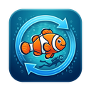
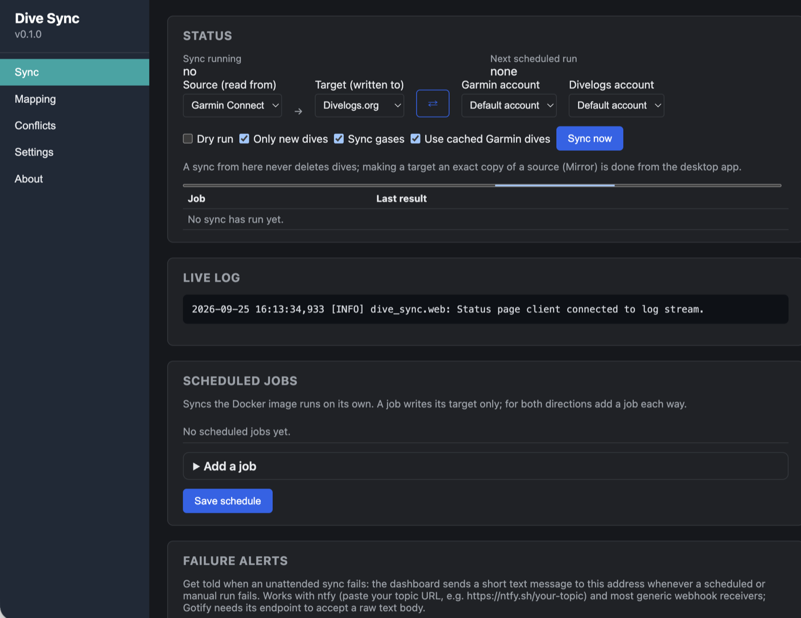

# Dive Sync 
## Keep a backup of your dives! I am using the app but there might be cases that will cause issues

Dive Sync is a dive log synchronization engine that matches and syncs your dive history between **Garmin Connect**, **Divelogs.org**, **Subsurface** (Subsurface Cloud, a Subsurface git checkout, or a UDDF file) and, in beta, **MySSI** (new dives only; see the limitations).

I started this project when i got back to diving and had to import all dives from logbooks to Garmin and to Divelogs.
I managed to make the import but the stability of the code wasn't good enough for release. Because of lack of time I didnt continue but with Gemini I saw the opportunity to finalize the project.

There are most likely cases that i have not thought about so be careful. 
I am using the container solution myself and also the app (macos) to clean up dives at Garmin.

It features two-way syncing (one direction per run), detailed telemetry parsing (depth/temperature graphs and gas mixture sensors), and multi-account support.

It comes in two forms that share the same sync engine and settings format:
* **The desktop app** (DiveSync, PySide6/Qt Quick; macOS first, Windows and Linux builds in CI): run syncs by hand, browse and edit your dives on each service, edit the mapping board, resolve conflicts, convert dive-computer files offline.
* **The Docker image**: an unattended, scheduled sync with a web dashboard (Sync now, scheduled jobs, live log, mapping board, conflicts, accounts). It syncs only; browsing and editing dives is the desktop app's job.

<p align="center">
  
  
</p>
<p align="center"><em>The desktop app (left) and the Docker image's web dashboard (right).</em></p>

<p align="left">
  <a href="https://skillicons.dev">
    
  </a>
</p>

---

## 🚀 Key Features

* **Two-Way Syncing, One Direction Per Run**: Every run reads a **source** and writes a **target** (to Divelogs, to Garmin, to Subsurface, ...). To keep two services in step both ways, run or schedule both directions — the second run sees what the first wrote, so nothing needs a tiebreak and no single run ever writes both sides.
* **Safe by default, Mirror on request**: a normal sync never deletes anything. The desktop app's **Mirror** option makes the target a copy of the source for one run (compares every dive, forces the mapped fields, deletes target dives the source doesn't have) — with a dry run to preview it.
* **Reliable matching**: dives are paired by stored links first, then by start time, and only then by match keys such as the dive number — so a renumbered log or a re-imported Garmin activity doesn't pair a dive with the wrong one.
* **Telemetry & Gas Mapping**: depth/temperature profiles, start/end tank pressures, gas mixtures (Nitrox/Trimix) and tank transmitter names (Garmin tank sensors).
* **Field-Level Mapping Board**: a drag-and-drop editor (desktop app and web dashboard) of what the target accepts from the source, field by field, with a policy per rule, composite templates, **splits** (e.g. Garmin's activity name "Gozo, Blue Hole" into Divelogs' location and dive site), and a queue for conflicts that need a manual pick.
* **Dive editing (desktop app)**: edit dives on Garmin Connect, Divelogs.org and Subsurface (MySSI dives can be browsed and deleted; editing them comes after the update test); changes are staged, shown in the list, and uploaded together with **Save all changes** (Garmin is slow — three requests per dive). Undo, staged deletes, Garmin FIT file downloads, and hand-logged Subsurface dives' duration and depths are editable too.
* **Metric or imperial**: choose **Metric** (m, bar, °C, L, kg) or **Imperial** (ft, psi, °F, cuft, lb) once on the desktop app's Settings page and every page follows, including what you type when editing; the web dashboard has the same choice under Settings and the CLI takes `--units` for one run. Dives, files and the services stay metric; only what is shown converts, rounded the way a dive computer does. See [Settings](docs/settings.md).
* **Dive edit (desktop app)**: open Garmin `.fit` files (or Connect's "export original" zip), UDDF or Subsurface `.ssrf` files - one at a time or a whole folder -, edit every field of a dive (times with the profile moving along, site and positions, buddy, weight, tanks, computer, gradient factors, water type, dive mode…) and save the dives as UDDF or Subsurface `.ssrf` - profile, tank pressures per transmitter, deco channels, events and the dive computer carried over - or, for a Garmin `.fit`, back as a `.fit` with only the changed values rewritten. **Merge…** joins a dive the computer split into several logs into one `.fit`, keeping the real times or closing the gaps. No account is involved (see [Dive edit](docs/convert.md)).
* **MySSI (beta)**: MySSI is a sync service like the others - on the desktop app's Sync page, the CLI (`--source garmin --target ssi`) and the web dashboard, with any number of MySSI accounts on Settings and a **MySSI Dives** page. MySSI has no public API, so DiveSync uses the MySSI app's own connection, which SSI can change or close at any time; a sync adds new dives only, skips a dive with two or more tanks, and never deletes on MySSI (not even Mirror). See [Sync](docs/sync.md) and [Advanced → Limitations](docs/advanced.md#limitations).
* **Scheduled Sync**: cron-like jobs (hourly/daily/weekly/custom interval, per-job pair, direction and filters) that run unattended in the Docker image, with optional alerts to a webhook (ntfy, Gotify, ...) on failed runs, and opt-in a summary after runs that changed something or after every run.
* **Multi-Account Support**: several Garmin and Divelogs accounts, selected per run from the CLI.
* **Scuba only**: from Garmin, single gas, multi gas, CCR, gauge and hand-logged dives are downloaded and synced. Apnea dives and spearfishing stay on Garmin.
* **Docker Ready**: Package and run the scheduler with custom port routing and unified volume mapping to persist settings, credentials, session tokens, and data caches.

---

## 🛠️ Installation

Installers for macOS, Windows and Linux are attached to the [Releases](https://github.com/mickemannen/dive_sync/releases) page; the scheduled sync runs as a Docker image:

```bash
docker pull mickemannen/dive_sync:latest      # see docs/docker.md for the volume, port and TZ
```

Or run from source (Python 3.10+):

```bash
pip install -r requirements.txt
pip install -e .
python setup_credentials.py    # accounts for the CLI and the Docker image (the desktop app asks on its Settings page)
python -m desktop              # the desktop app
python sync.py --dry-run       # the command line
```

See [Getting started](docs/getting-started.md) for the credentials and where your data is kept, [Docker](docs/docker.md) for the container, and [Building and releasing](docs/building.md) to package it yourself.

---

## 📚 Documentation

The full documentation is in [`docs/`](docs/README.md):

| | |
|---|---|
| **The desktop app** | [Overview](docs/desktop-app.md) · [Sync](docs/sync.md) · [Dives](docs/dives.md) · [Mapping](docs/mapping.md) · [Conflicts](docs/conflicts.md) · [Dive edit](docs/convert.md) · [Settings](docs/settings.md) |
| **Reference** | [Command line](docs/cli.md) · [Configuration files](docs/configuration.md) · [Docker](docs/docker.md) · [Web dashboard](docs/web-dashboard.md) · [Advanced](docs/advanced.md) · [Building and releasing](docs/building.md) · [How it works](docs/technical.md) |

---

## ⚠️ Limitations

Beta quality: Garmin → Divelogs and Garmin → Subsurface are the exercised paths, the other directions much less so, so keep backups. Gases and tanks reach Garmin Connect only when a new dive is uploaded as a `.fit` (opt-in, beta; its API accepts none), Divelogs numbers dives itself, MySSI takes new dives only through an unofficial connection (no updates, no deletes from a sync, two-tank dives skipped), multi-account works only from the CLI, and the web dashboard has no login. The full list is in [Advanced → Limitations](docs/advanced.md#limitations); what the dashboard needs to be safe is under [Docker → Security](docs/docker.md#security).

---

## 🙏 Acknowledgements
* **[libdivecomputer](https://github.com/libdivecomputer/libdivecomputer)** (LGPL-2.1, Jef Driesen and contributors) is the reference for the Shearwater dive computer's log format. DiveSync's decoder of the Shearwater app's profile blobs (`src/core/services/shearwater_log.py`) follows the field layout documented in its `shearwater_predator_parser.c`, re-implemented in Python; the module records the upstream revision it was checked against so a change there is easy to spot. No libdivecomputer code is included.
* **[Garmin FIT SDK](https://developer.garmin.com/fit/download/)** (the `garmin-fit-sdk` package, under Garmin's FIT Protocol License) is Garmin's own library for its FIT format; the Dive edit page writes a Garmin `.fit` from a dive that did not come from one with its encoder (`src/core/convert/fit_writer.py`). Everything else about FIT files - reading them, patching an opened `.fit` with edits, merging a split dive - is done without it.

## 📄 License
MIT, see [LICENSE](LICENSE). The desktop app uses PySide6 (Qt for Python), which is LGPL and linked dynamically; that is compatible with the MIT licence of this project. Garmin FIT files are read with [fitdecode](https://github.com/polyvertex/fitdecode) (MIT, Jean-Charles Lefebvre) and written with Garmin's [FIT SDK](https://developer.garmin.com/fit/download/) (the `garmin-fit-sdk` package, under Garmin's own FIT Protocol License, included in the installers and the Docker image). Garmin Connect, Divelogs.org, Subsurface and Shearwater are the names of their owners' products and services; this is an independent project, not affiliated with them.
