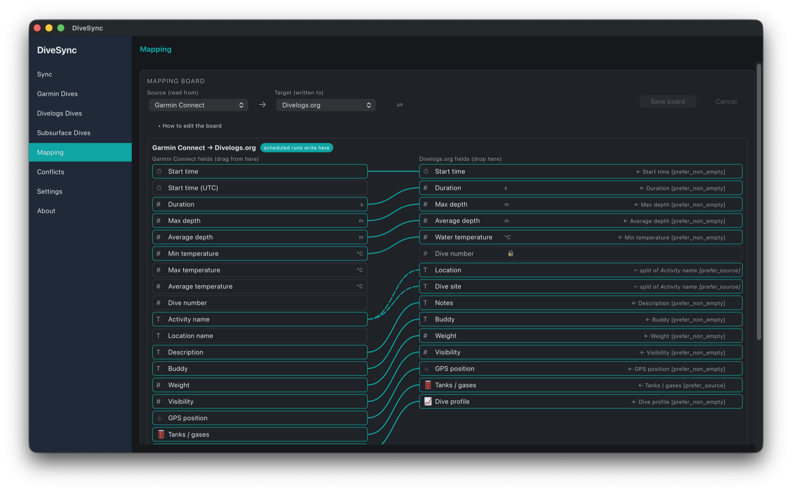
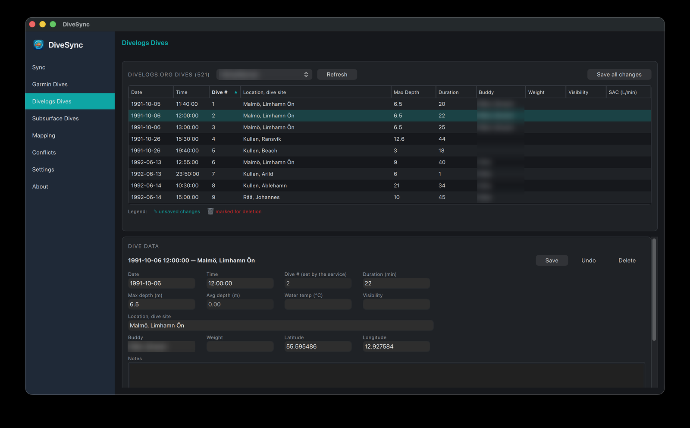
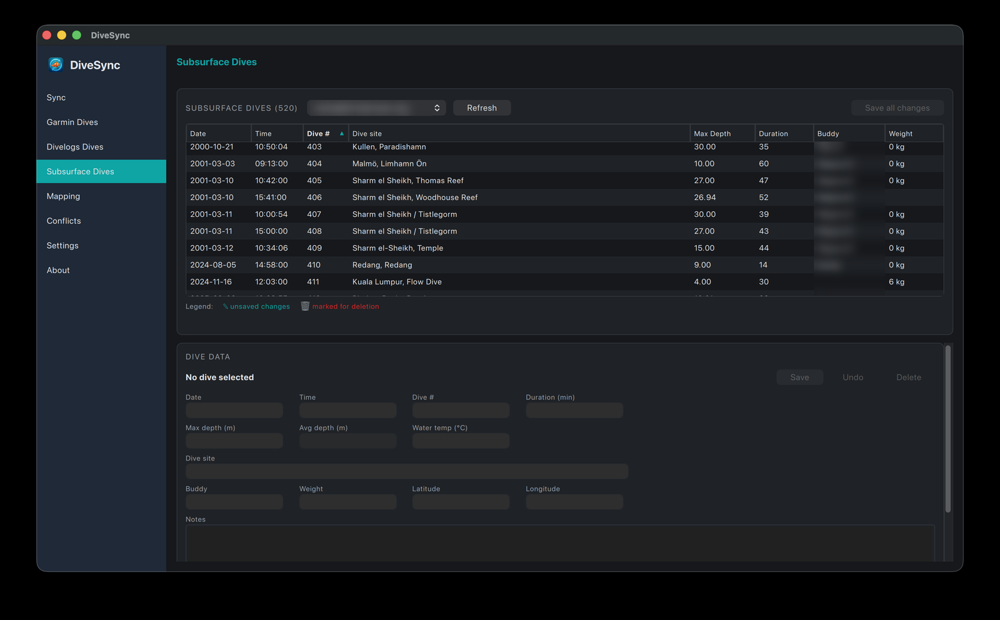

# Desktop app

DiveSync (PySide6/Qt Quick; macOS first, Windows and Linux builds in CI) is the hands-on side of the project: run syncs by hand, browse and edit your dives on each service, edit the mapping board, resolve conflicts, convert dive-computer files offline.
```bash
python -m desktop          # from a source checkout
briefcase dev              # the same, through Briefcase
briefcase build macOS app && briefcase package macOS app    # a DiveSync.app / installer
```
Pre-built installers are attached to the GitHub releases (built by `.github/workflows/desktop-build.yml`). The app keeps its settings and caches in its own data folder (shown on the **About** page) and credentials in the OS keychain.

The pages, one per entry in the sidebar:

| Page | What it's for |
|---|---|
| [Sync](sync.md) | Pick a source and a target and sync now; download dives for the Dives pages. |
| [Dives](dives.md) | Garmin, Divelogs, Subsurface and MySSI dives in a table; edit, stage and save (MySSI: browse and delete until the update test). |
| [Mapping](mapping.md) | The mapping board: what the target takes from the source, field by field. |
| [Conflicts](conflicts.md) | Queued conflicts with the two values side by side. |
| [Dive edit](convert.md) | Dive-computer files in, every field of a dive editable, UDDF, Subsurface or (for Garmin) `.fit` files out; merge a split dive; no account involved. |
| [Settings](settings.md) | Accounts (kept in the OS keychain), the sync profile, About. |

<table>
  <tr>
    <td><br><sub><b>Sync</b>: source → target, options, Download dives and the run log</sub></td>
    <td><br><sub><b>Mapping</b>: what the target takes from the source, with a split (dashed)</sub></td>
  </tr>
  <tr>
    <td><br><sub><b>Garmin Dives</b>: FIT status per dive, staged edits, Save all changes</sub></td>
    <td><br><sub><b>Divelogs Dives</b>: the same editor for Divelogs.org</sub></td>
  </tr>
  <tr>
    <td><br><sub><b>Settings</b>: accounts (kept in the OS keychain) and the sync profile</sub></td>
    <td><br><sub><b>Subsurface Dives</b>: the same editor for Subsurface Cloud, with its own account picker</sub></td>
  </tr>
</table>
