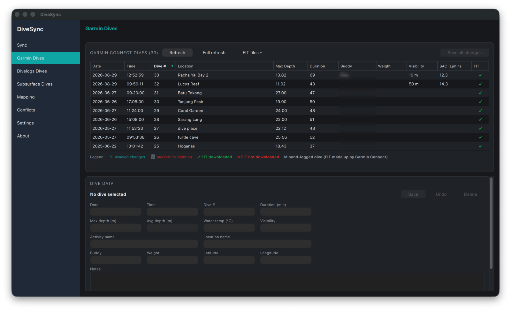

# Dives (Garmin, Divelogs, Subsurface)

Every dive of that service in a sortable table (pick columns with a right-click on the header). Select a dive to edit it; edits are staged (✎) and shown in the table, deletions are staged too (🗑), **Undo** drops them, and **Save all changes** uploads them in one go (on Divelogs and Subsurface, **Save** uploads a single dive right away). On Garmin: separate *Activity name* and *Location name*, a **FIT files** menu to download the original `.fit` files (✓ downloaded, ✗ not yet, M hand-logged), and **Full refresh** that re-fetches every dive and its FIT file. On Subsurface, duration and depths come from the dive profile, so they are editable on hand-logged dives only. With several accounts, each page has its own account picker next to **Refresh** (remembered, independent of the Sync page); every account's dives are kept in their own folder. Depths, temperatures, SAC, tank sizes and pressures, weight and visibility are shown and typed in the unit system chosen under **Units** on the Settings page (metric or imperial); what is stored and sent to the services stays metric, and a field you leave as shown is saved exactly as it was.

The Garmin page reads from the app's Garmin cache, see [Garmin dive cache](advanced.md#garmin-dive-cache).
