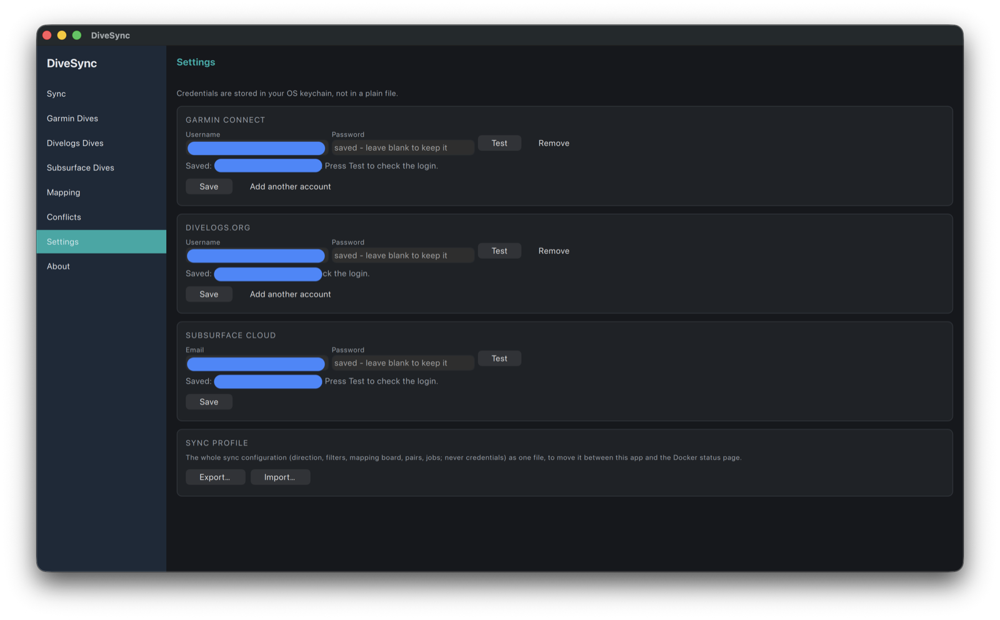

# Settings and About

**Settings** — any number of accounts for Garmin Connect, Divelogs.org, Subsurface Cloud and MySSI (with a login test), and export/import of the whole sync configuration as a profile.

**About** — version, update check, license, data folder.

**Units** — a card on the Settings page, after the account cards, with two choices: Metric (m, bar, °C, L, kg) or Imperial (ft, psi, °F, cuft, lb). The switch applies at once, with no Save, and is remembered on this computer (it is not part of the exported sync profile). It only changes what is shown: your dives, the caches, the files the app writes and the services stay metric.

**MySSI** (beta) - an account list like Divelogs': any number of MySSI logins (the email and password of the MySSI app), each with **Test** (logs in without keeping anything), **Save** (stores them in the OS keychain; a blank password keeps the stored one) and **Remove**. The note under the title says what the beta means: MySSI has no public API, so DiveSync uses the MySSI app's own unofficial connection, which SSI can change or close at any time; a sync **adds new dives only** (changes to dives already on MySSI are not sent until updating has been tested) and **skips a dive with two or more tanks**. The one login an earlier version kept for the Dive edit page's Open MySSI / Send to SSI (both gone) was moved into this list once. With an account saved, MySSI is a source and a target on the [Sync](sync.md) page, has a board on [Mapping](mapping.md), appears on [Conflicts](conflicts.md) and gets its own [MySSI Dives](dives.md) page.

The Shearwater app card (desktop only) is described under [Other services](cli.md#other-services-uddf-files-subsurface-and-the-shearwater-app). Credentials never leave the OS keychain except for the duration of an operation; the CLI and the Docker image use `credentials.json` instead, see [Configuration files](configuration.md).
