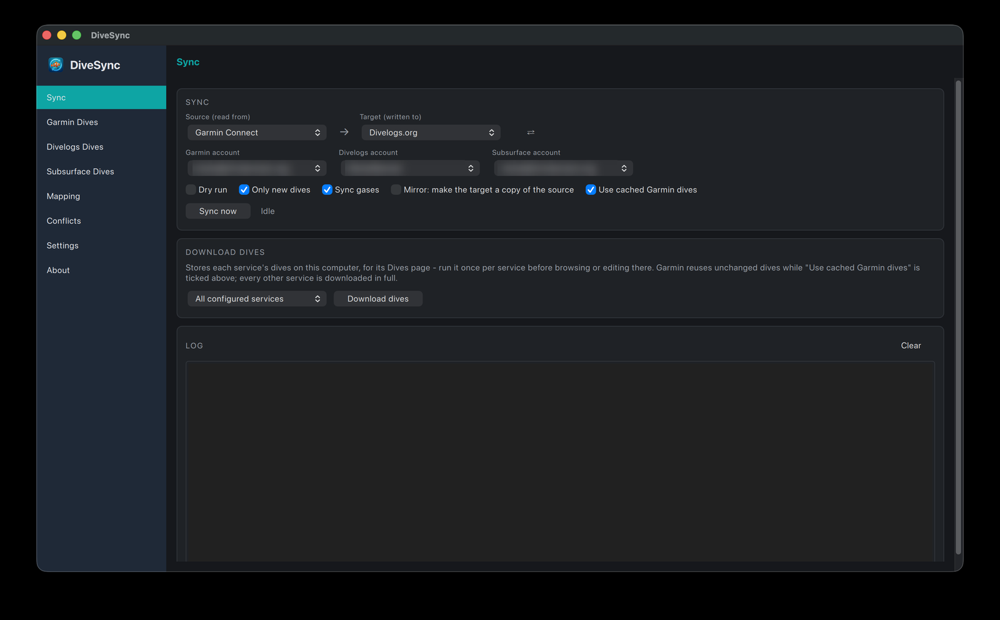

# Sync

Pick a **source** and a **target** (⇄ swaps them) and press **Sync now**. Options: *Dry run*, *Only new dives*, *Sync gases*, *Mirror* (make the target a copy of the source; asks for confirmation) and *Use cached Garmin dives*. With several accounts for a service, pick which one to sync with next to the source and target (remembered). **Download dives** stores each service's dives on this computer for its Dives page (only the picked accounts); the run log is below.

**MySSI** (beta) is a source and a target like the others once an account is saved on [Settings](settings.md), with its own **MySSI account** picker when there are several; a note under the Source/Target row says what the beta means. Towards MySSI a sync **adds new dives only**: a dive already on MySSI is matched (by the sync history, by the dive-computer reference DiveSync sent with it, or by its start time) but changes to it are not sent, and the log says so for each such dive, until updating has been tested; a dive with two or more tanks is skipped with a line saying why; and **Mirror never deletes on MySSI** - it logs each dive it would have deleted and leaves it (a MySSI delete is permanent, and the dive number may not come back). Reading MySSI is one request for the whole logbook, so **Download dives** for its Dives page is quick. The connection is the MySSI app's own, unofficial one, which SSI can change or close at any time.

A sync started from this page never deletes unless *Mirror* is ticked. What a run does with each field is decided by the pair's [mapping board](mapping.md); the same engine runs from the [command line](cli.md) and the [Docker image](docker.md).
