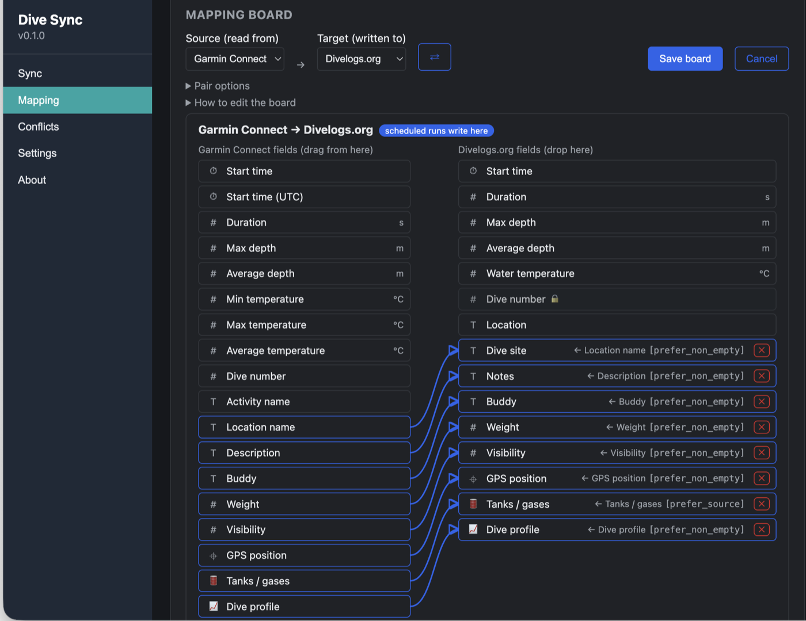
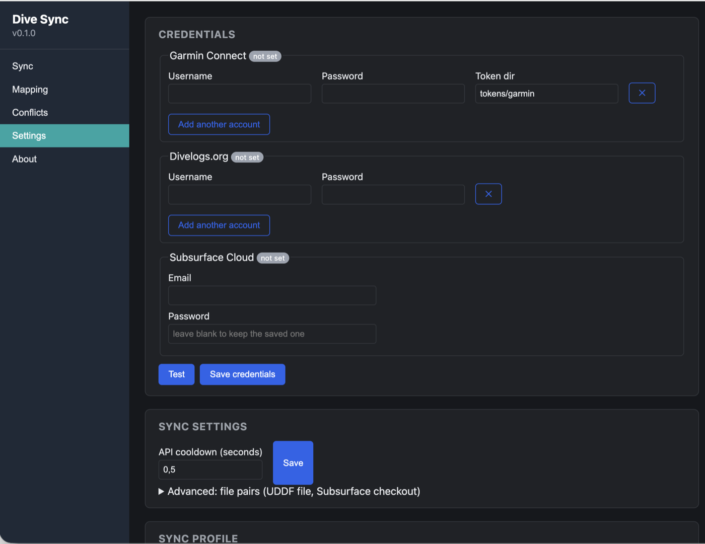

# Web dashboard

Start the web dashboard locally without Docker:
```bash
python docker_run.py
```
Open `http://localhost:8000` in your web browser. It is the unattended side of the project: it syncs, it does not browse or edit dives (that is the desktop app). The pages:
1. **Sync**: whether a sync is running, the next scheduled run, and **Sync now** for a source → target (dry run, only new dives, sync gases, use cached Garmin dives) with its progress and the live log; **Scheduled jobs** as a list ("Garmin Connect → Divelogs.org, every day at 06:00") with **Add job** asking what and when, and **Run** to start a saved job right away (as the scheduler would, even when it is disabled); MySSI (beta) is a source and a target like the others once an account is saved - a note under the Source/Target row says what the beta means (new dives only, a dive with two or more tanks skipped, the unofficial connection), and with several MySSI accounts a **MySSI account** picker appears next to Sync now and in the job editor; and **Failure alerts**: a webhook (e.g. an ntfy topic) that gets a short message whenever a run fails. A sync from here never deletes dives — Mirror is desktop-only.
2. **Mapping**: the mapping board for a source → target and the pair's options — see [Mapping](mapping.md).
3. **Conflicts**: every pair's queued conflicts with **Keep this** per side; a pick is staged (green, click again to undo) and written by the **Save** button of the service that gets the update.
4. **Settings**: Garmin, Divelogs.org, Subsurface Cloud and MySSI credentials (with a test; MySSI is an account list under its beta note, a blank password keeps the stored one), the API cooldown, file pairs (UDDF file, Subsurface checkout) under *Advanced*, and the sync profile export/import. A **Units** select (Metric or Imperial) next to the API cooldown picks how this dashboard shows depths, temperatures, weights and visibility - on the Conflicts page, in the Mapping page's test table, in a run's conflicts in the history and in the live log of the runs started here; your dives, files and the services stay metric, and the choice is the dashboard's own (kept in `web_prefs.json` in the data folder), not part of the sync profile.
5. **About**: version (the Docker image's `APP_VERSION`), update check and license.

<table>
  <tr>
    <td><br><sub><b>Sync</b>: Sync now, the live log and scheduled jobs</sub></td>
    <td><br><sub><b>Mapping</b>: the same board as the desktop app</sub></td>
    <td><br><sub><b>Settings</b>: accounts, API cooldown, file pairs, profile</sub></td>
  </tr>
</table>
